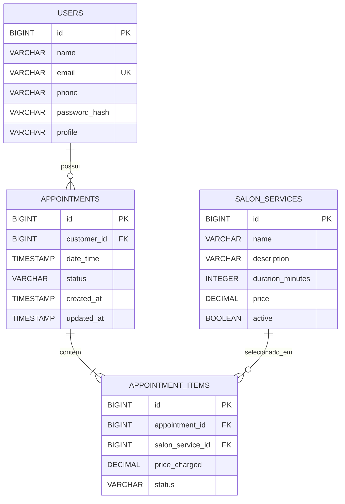

# Cabeleleila Leila — sistema de agendamento

Aplicação web para consultar serviços do salão, criar agendamentos com um ou mais serviços, visualizar o histórico e permitir que a Leila acompanhe e gerencie os atendimentos.

## Tecnologias

- Java 17
- Spring Boot 4.1.1
- Spring MVC, Spring Data JPA, Bean Validation e Spring Security
- H2 2.x, em modo arquivo durante o uso local
- Maven Wrapper
- HTML, CSS e JavaScript ES Modules, sem framework frontend
- springdoc OpenAPI 3.1.0

## Por que H2

O H2 foi escolhido por ser um banco relacional leve, fácil de iniciar junto com a aplicação e não exigir instalar ou manter um servidor de banco separado. Isso deixa o projeto simples de executar e torna os testes mais rápidos: o teste de inicialização usa um H2 em memória isolado, enquanto o desenvolvimento usa H2 em arquivo para preservar os dados entre execuções.

O console web do H2 também facilita visualizar tabelas e conferir os dados que o JPA e a aplicação gravaram. Com a aplicação em execução, abra `http://localhost:8081/h2-console` e use:

| Campo | Valor |
|---|---|
| JDBC URL | `jdbc:h2:file:./data/cabeleleila` |
| User Name | `sa` |
| Password | deixe em branco |

Exemplos de consulta para explorar os dados:

```sql
SELECT * FROM USERS;
SELECT * FROM SALON_SERVICES;
SELECT * FROM APPOINTMENTS ORDER BY DATE_TIME;
SELECT * FROM APPOINTMENT_ITEMS;
```

O H2 e seu console são adequados para desenvolvimento e avaliação local, não para produção. Para produção, seria apropriado usar um banco dedicado e rever políticas de acesso, credenciais, backups e configuração do console.

## Executar localmente no Windows

É necessário ter um JDK 17 instalado. O Maven Wrapper já está no projeto; não é necessário instalar Maven separadamente.

1. Abra a pasta do projeto no IntelliJ.
2. Em **Run → Edit Configurations**, selecione a configuração da aplicação e defina as variáveis de ambiente:
   - `ADMIN_EMAIL`: e-mail que será usado pela conta ADMIN da Leila.
   - `ADMIN_PASSWORD`: senha escolhida localmente para essa conta.
3. Inicie `CabeleleilaApplication` por essa configuração.

Alternativamente, numa sessão local de PowerShell, defina as variáveis antes de iniciar:

```powershell
$env:ADMIN_EMAIL = "leila@exemplo.local"
$env:ADMIN_PASSWORD = "defina-uma-senha-localmente"
.\mvnw.cmd spring-boot:run
```

Os valores acima são somente exemplos. Escolha sua própria senha localmente; não a envie para terceiros e não grave credenciais reais no código, neste README ou no Git. A conta ADMIN é criada no primeiro início se o e-mail ainda não existir. A senha é armazenada com BCrypt; mudar as variáveis depois não redefine automaticamente uma conta que já foi criada.

Endereços locais:

- Aplicação e páginas: `http://localhost:8081`
- Agendamento: `http://localhost:8081/agendar.html`
- Histórico: `http://localhost:8081/meus-agendamentos.html`
- Área da Leila: `http://localhost:8081/admin.html` (exige login e perfil ADMIN)
- OpenAPI: `http://localhost:8081/swagger-ui.html`
- Health do Actuator: `http://localhost:8082/actuator/health`

Para executar os testes:

```powershell
.\mvnw.cmd test
```

Os testes de contexto usam propriedades de conta ADMIN fictícias e H2 em memória, portanto não dependem das variáveis do IntelliJ nem escrevem no banco de desenvolvimento.

## Arquitetura

O backend está organizado por responsabilidade:

| Pacote | Responsabilidade |
|---|---|
| `controller` | Rotas HTTP, leitura de parâmetros/JSON e status HTTP |
| `service` | Regras de negócio e coordenação das operações |
| `repository` | Consultas e persistência JPA |
| `model` | Entidades do banco e enums de estado |
| `dto` | Contratos de entrada e saída da API |
| `exception` | Exceções de domínio e tradução central para HTTP |
| `config` | Configuração de Security e criação inicial do ADMIN |

O frontend é servido pelo Spring Boot em `src/main/resources/static`. Os módulos `js/api.js`, `js/app.js`, `js/history.js` e `js/admin.js` usam `fetch` para conversar com a API na mesma origem. A separação de camadas permite que o controller permaneça simples, que regras sejam testáveis sem navegador e que o repository concentre acesso ao banco.

## Modelo de dados

### Diagrama entidade-relacionamento



### Relacionamento das tabelas

Um agendamento pertence a um usuário e possui um ou mais itens. `APPOINTMENT_ITEMS` é a entidade de associação entre agendamento e serviço porque essa relação também guarda dados próprios: o preço cobrado naquele momento e o status daquele serviço. Assim, uma alteração futura no preço do catálogo não altera o histórico financeiro do agendamento.

Os enums de perfil e status são persistidos pelo nome, não pelo número ordinal. O Hibernate deriva as tabelas das entidades JPA; `spring.jpa.hibernate.ddl-auto=update` está configurado para desenvolvimento. `data.sql` é lido em UTF-8 para preservar acentos e insere clientes e serviços de demonstração: **Corte de cabelo**, **Coloração** e **Escova**. As senhas de seed dos clientes são marcadores de demonstração, não contas de login válidas.

## Regras de negócio

- Cada agendamento tem uma data/hora e um ou mais serviços.
- Os serviços enviados devem existir, estar ativos e não podem aparecer duplicados no mesmo pedido.
- Horários aceitos: segunda a sábado, entre 09:00 e 16:00. A regra é verificada no backend, não apenas no navegador.
- Se a cliente já tiver um agendamento `PENDING` ou `CONFIRMED` na mesma semana (segunda a domingo), o backend solicita uma decisão. A sugestão usa a data/hora do primeiro agendamento ativo; a primeira chamada não salva nada.
- A cliente só consegue alterar seu próprio agendamento e somente quando faltam pelo menos dois dias. A validação do backend continua sendo a autoridade, mesmo que a interface esconda/desabilite a ação.
- A Leila pode editar agendamentos `PENDING` ou `CONFIRMED` sem a restrição de dois dias. Alterar serviços recria os itens com os preços atuais e reinicia seus status para pendente.
- A Leila pode confirmar agendamentos pendentes, cancelar agendamentos pendentes/confirmados e atualizar o estado individual dos serviços. Quando todos os itens de um agendamento confirmado ficam concluídos, o agendamento passa para `COMPLETED`.
- Dashboard: semana atual de segunda a domingo; faturamento soma os preços históricos dos agendamentos concluídos; serviços mais pedidos contam itens não cancelados e mostram até cinco resultados.

## API principal

| Método | Rota | Acesso | Descrição |
|---|---|---|---|
| `GET` | `/services` | Público | Catálogo de serviços ativos |
| `POST` | `/appointments` | Público nesta versão | Criar agendamento / receber solicitação de sugestão |
| `GET` | `/appointments?from=AAAA-MM-DD&to=AAAA-MM-DD` | Público nesta versão | Histórico usando `X-Customer-Id` |
| `PUT` | `/appointments/{id}` | Público nesta versão | Alteração online da cliente, usando `X-Customer-Id` |
| `GET` | `/api/csrf` | Público | Materializar o token CSRF para a aplicação JavaScript |
| `GET` | `/api/admin/appointments` | ADMIN | Listar agendamentos com nome da cliente |
| `PUT` | `/api/admin/appointments/{id}` | ADMIN + CSRF | Alterar data e serviços |
| `PUT` | `/api/admin/appointments/{id}/confirm` | ADMIN + CSRF | Confirmar |
| `PUT` | `/api/admin/appointments/{id}/cancel` | ADMIN + CSRF | Cancelar |
| `PUT` | `/api/admin/appointments/{id}/services/{itemId}/status?status=...` | ADMIN + CSRF | Atualizar estado de um item |
| `GET` | `/api/admin/appointments/dashboard` | ADMIN | Métricas da semana atual |

Os controllers delegam regras ao service e retornam DTOs, não entidades JPA. `GlobalExceptionHandler` traduz erros de negócio para respostas HTTP. Por exemplo, recursos inexistentes retornam 404, dados/horários inválidos retornam 400 e transições de estado não permitidas retornam 409.

## Segurança

O Spring Security autentica a Leila por formulário e sessão. A conta é carregada por e-mail; a senha é comparada usando BCrypt. `SecurityConfig` exige perfil `ADMIN` para `admin.html` e `/api/admin/**`. O identificador de sessão fica em cookie mantido pelo framework; o frontend não inventa um cookie de autorização.

As ações administrativas de escrita exigem token CSRF. A configuração SPA usa o cookie `XSRF-TOKEN`, e o frontend envia o valor no cabeçalho `X-XSRF-TOKEN`. O console H2 está habilitado e configurado para o uso local.

O health do Actuator está disponível na porta `8082` e retorna somente o status, sem expor detalhes internos do banco ou do ambiente.

## Testes

- `AppointmentServiceTest`: regras de criação, sugestão semanal, horário, alteração, histórico, transições administrativas e métricas.
- `AppointmentControllerTest`: validação de entrada, status HTTP de criação e tratamento de erro.
- `CabeleleilaApplicationTests`: inicialização do contexto completo e conferência dos nomes dos serviços seed, com propriedades fictícias e banco H2 em memória.

Comando completo: `.\mvnw.cmd test`.

## Limitações conhecidas e escopo

- A identidade da cliente é provisória: o frontend usa `customerId = 1` e a API aceita `X-Customer-Id`. Esse header não é autenticação segura. Escolhi manter o login de clientes fora do escopo desta etapa; portanto, a aplicação não deve ser tratada como multiusuário.
- A conta ADMIN é criada automaticamente somente se o e-mail ainda não existir; mudar a senha em variável de ambiente não redefine a senha já persistida.
- O H2 em arquivo e `ddl-auto=update` priorizam simplicidade de desenvolvimento, não migrações e operação de produção.

## Entrega

As capturas de tela estão em `docs/prints` (`agendamento.jpg`, `meus-agendamentos.jpg` e `area-leila.jpg`). O vídeo de demonstração está em `docs/cabeleleila_leila_demo.mp4`.